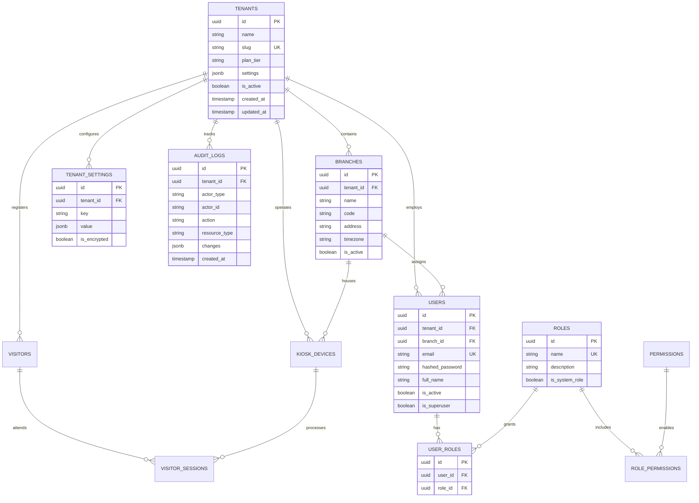

# Database Design & Multi-Tenant Schema Specification

## 1. Engine & Connectivity
- **RDBMS**: PostgreSQL 16
- **ORM**: SQLAlchemy 2.0 (AsyncIO)
- **Driver**: `asyncpg` (Async engine) and `psycopg2-binary` (Synchronous Alembic engine)
- **Connection Pool**: `QueuePool` with `pool_size=10`, `max_overflow=20`, `pool_timeout=30`, `pool_pre_ping=True`

---

## 2. Entity-Relationship Diagram

---

## 3. Data Dictionary

### `tenants`
Root organizational boundary for multi-tenancy.
- `id` (UUID, PK): Unique tenant ID.
- `name` (VARCHAR(255)): Official organization name.
- `slug` (VARCHAR(100), UNIQUE): URL and subdomain friendly slug.
- `plan_tier` (VARCHAR(50)): Tier (`enterprise`, `business`).
- `settings` (JSONB): Core tenant configuration.
- `is_active` (BOOLEAN): Status flag.

### `branches`
Physical facilities or branches operated by a tenant.
- `id` (UUID, PK)
- `tenant_id` (UUID, FK -> `tenants.id` ON DELETE CASCADE)
- `name` (VARCHAR(255)): Branch name (e.g. "HQ Tower A", "London Office").
- `code` (VARCHAR(50)): Unique code within tenant.
- `timezone` (VARCHAR(100)): Local timezone.

### `users`
Authenticated personnel.
- `id` (UUID, PK)
- `tenant_id` (UUID, FK -> `tenants.id` ON DELETE CASCADE)
- `branch_id` (UUID, FK -> `branches.id` ON DELETE SET NULL, Optional)
- `email` (VARCHAR(255), Index): Corporate email.
- `hashed_password` (VARCHAR(255)): Salted bcrypt password hash.
- `full_name` (VARCHAR(255)): User display name.
- `is_active` (BOOLEAN): Account status.

### `roles` & `permissions`
Role-Based Access Control matrix (`SUPER_ADMIN`, `BUSINESS_ADMIN`, `BRANCH_ADMIN`, `RECEPTIONIST`, `EMPLOYEE`).

### `tenant_settings`
Configurable parameters (voice greetings, printer pairing, badge templates).

### `audit_logs`
Append-only log of security, administrative, and kiosk operations for compliance.
