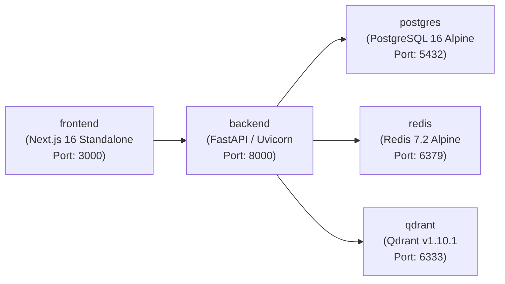

# Docker & Infrastructure Setup Guide

## Overview
The platform provides production-ready Docker containers and Docker Compose topology ensuring consistent deployment across local developer environments, staging clusters, and AWS ECS/EKS.

---

## 1. Services Architecture



---

## 2. Docker Compose Commands

### Start All Services (Detached Mode)
```bash
cd infra
docker compose up -d --build
```

### Inspect Container Health & Status
```bash
docker compose ps
```

### Stream Logs from Specific Services
```bash
docker compose logs -f backend
docker compose logs -f postgres
docker compose logs -f redis
docker compose logs -f qdrant
```

### Stop All Services & Preserve Volume Data
```bash
docker compose down
```

### Tear Down Volumes (Clean Database Reset)
```bash
docker compose down -v
```

---

## 3. Persistent Volumes
- `ai_receptionist_postgres_data`: Stores PostgreSQL table schemas and visitor records.
- `ai_receptionist_redis_data`: Retains Redis session caches and rate limit counters across restarts.
- `ai_receptionist_qdrant_data`: Stores vector embeddings for the receptionist knowledge base.

---

## 4. Container Hardening
- **Non-root Execution**: The backend (`appuser`, uid 1001) and frontend (`nextjs`, uid 1001) Dockerfiles execute under dedicated unprivileged users.
- **Multi-Stage Builds**: Builder images strip compilation toolchains, keeping runtime images lean and eliminating attack surfaces.
- **Health Checks**: Containers declare interval-based healthchecks (`pg_isready`, `redis-cli ping`, `curl /api/v1/health/`).
