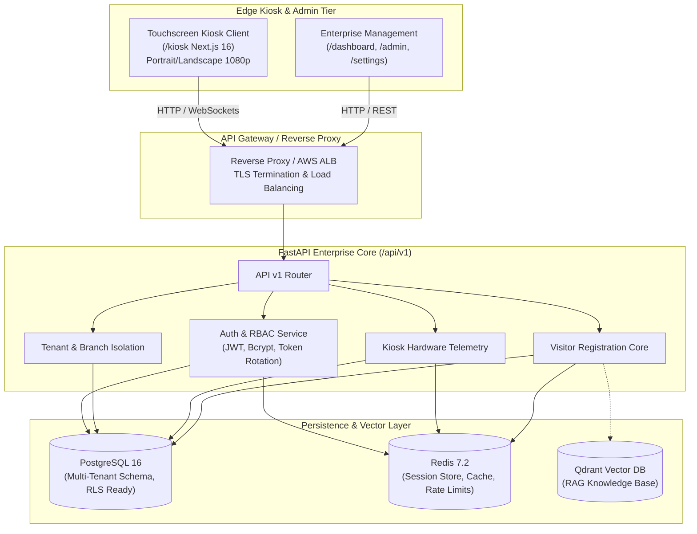

# Project Architecture: AI Receptionist Enterprise

## 1. System Overview & Product Context
The **AI Receptionist Enterprise** is an enterprise-grade virtual receptionist platform designed for physical touchscreen kiosks deployed in commercial lobbies, office branches, and corporate headquarters.



---

## 2. Directory Layout & Monorepo Boundaries

```text
ai-receptionist-enterprise/
├── frontend/                     # Next.js 16 App Router & UI System
│   ├── src/
│   │   ├── app/
│   │   │   ├── (auth)/login/     # Enterprise authentication
│   │   │   ├── (kiosk)/kiosk/    # Fullscreen physical kiosk UI
│   │   │   ├── (admin)/admin/    # Kiosk fleet management
│   │   │   ├── (admin)/dashboard/# Real-time visitor logs
│   │   │   ├── (admin)/settings/ # Tenant & policy settings
│   │   │   ├── layout.tsx        # Global layout
│   │   │   └── page.tsx          # Product landing page
│   │   ├── components/
│   │   │   ├── kiosk/            # Avatar stage, status banner, action bar
│   │   │   └── ui/               # Reusable Shadcn UI primitives
│   │   └── lib/                  # Typed API client, utility functions
│   ├── package.json
│   └── Dockerfile
├── backend/                      # Python FastAPI core
│   ├── app/
│   │   ├── api/v1/endpoints/     # auth, health, root, tenants, users
│   │   ├── core/                 # config, errors, logging, security
│   │   ├── db/                   # base, session
│   │   ├── models/               # tenants, branches, users, roles, kiosks, visitors, audits
│   │   ├── schemas/              # Pydantic v2 schemas
│   │   └── services/             # Health probes, telemetry
│   ├── alembic/                  # Database migration versions
│   ├── tests/                    # Pytest async test suite
│   ├── requirements.txt
│   └── Dockerfile
├── infra/                        # Docker compose & service configurations
│   ├── docker-compose.yml
│   └── docker/
│       ├── postgres/init-db.sql
│       └── redis/redis.conf
├── docs/                         # Architecture, API, Security, Deployment specs
└── scripts/                      # Setup and test scripts
```

---

## 3. Core Architectural Decisions

### A. Strict Multi-Tenancy & Authorization
- **Tenant Context**: Established exclusively via authenticated JWT claims (`tenant_id`). The system never trusts unverified client-provided tenant headers or query parameters.
- **Role-Based Access Control (RBAC)**:
  - `SUPER_ADMIN`: Cross-tenant fleet management and tenant provisioning.
  - `BUSINESS_ADMIN`: Tenant-level user management and policy controls.
  - `BRANCH_ADMIN`: Branch-specific devices and visitor management.
  - `RECEPTIONIST`: Lobby terminal assistance and badge printing.
  - `EMPLOYEE`: Host visit confirmations and visitor notifications.

### B. Hardware Kiosk Reliability
- **Tactile UI**: Large touch targets (minimum 48×48px), high contrast mode support, and text scaling.
- **Fail-Safe Probing**: Dedicated `/api/v1/health/*` subsystem endpoints allow container orchestrators and kiosk edge agents to determine exact service availability.
